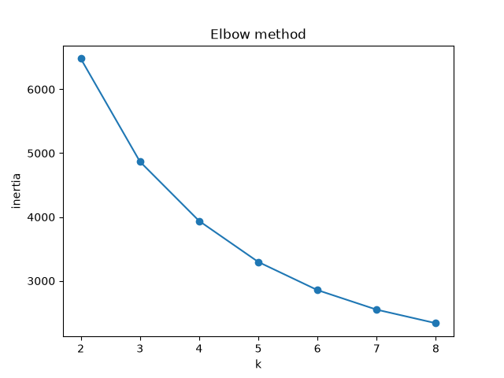
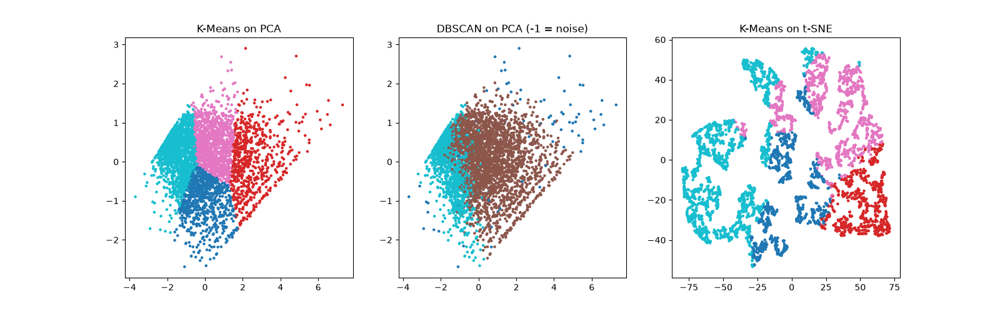

# Case Study 3: Customer Segmentation

Segments customers using Recency, Frequency, and Monetary (RFM) values, compares K-Means with DBSCAN, and visualizes the results with PCA and t-SNE.

## Files

- `code.py`: preprocessing, clustering, visualizations, metrics, and customer personas.
- `dataset.csv`: 4,338 customers with `CustomerID`, `Recency`, `Frequency`, and `Monetary` columns.
- `output.txt`: supplied console output, including silhouette scores and customer segment summaries. It replaces the previous PDF report.
- `elbow.png`: K-Means inertia for k values from 2 to 8.
- `clusters.png`: K-Means and DBSCAN on PCA coordinates, plus K-Means on t-SNE coordinates.
- `requirements.txt`: Python dependencies.

## Method

The script applies `log1p` and standard scaling to the three RFM features. It reports silhouette scores for k=2 through k=8, then uses a fixed four-cluster K-Means model for customer personas. DBSCAN uses `eps=0.5` and `min_samples=10`. Both clustering algorithms fit the three standardized RFM features; PCA and t-SNE are used for visualization. Persona descriptions are assigned by ranking clusters by average monetary value.

## Charts

### Elbow method



### Cluster visualizations



## Run

Use Python 3.11 or 3.12 in a virtual environment. Run from the repository directory so the script can find `dataset.csv`:

```powershell
python -m venv .venv
.venv\Scripts\Activate.ps1
python -m pip install -r requirements.txt
python code.py
```

The script prints results to the console and writes `elbow.png` and `clusters.png` in the working directory. To capture a new text output as well:

```powershell
python -u code.py > output.txt 2>&1
```

## Source and attribution

The current script, dataset, text output, and charts were supplied by the repository owner and copied without modification. The script identifies the RFM table as derived from the [UCI Online Retail dataset](https://doi.org/10.24432/C5BW33), D. Chen (2015), licensed under [CC BY 4.0](https://creativecommons.org/licenses/by/4.0/).

The earlier repository version was imported from [adityasinghin01-hash/case-study-3](https://github.com/adityasinghin01-hash/case-study-3) at commit `dfbcb8678962e71b21f31c08a5b08c9e86137e77`.

## Verification

Python syntax, dataset columns, unique customer IDs, and finite nonnegative RFM values were checked. The five replacement files were verified byte for byte against the supplied files, and both PNG dimensions were checked. The supplied output and charts were not regenerated locally.
